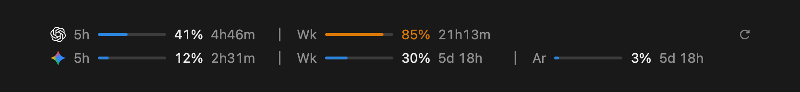

# ai-usage-meter

[English](README.md) | 日本語

Claude Code で作業しながら、Codex と Antigravity の使用量の上限を確認できます。この mod はプロンプトの上に小さな帯を追加し、各上限の使用量とリセットまでの時間を表示します。



*サンプル値を使った、mod 自身のグラフィックによるダークモードのイメージ図です（表示は英語）。*

## インストール

Claude Code のターミナルセッションのプロンプトに入力します。

```
/plugin install ai-usage-meter --marketplace bsw0610/ai-usage-meter
```

マーケットプレイスの追加を聞かれたら `y` と答え、スコープを選びます。

シェルから実行することもできます。

```bash
claude plugin install ai-usage-meter --marketplace bsw0610/ai-usage-meter --config language=ja
```

## 必要なもの

| ソース | 条件 |
|---|---|
| Codex | `PATH` 上の `codex` CLI と Node.js。ない場合は `~/.codex/sessions` の最近のログを読みます。 |
| Antigravity | サインイン済みの `agy` CLI。1.4.12 で動作を確認しています。 |

セッションの `PATH` にプログラムが見つからないソースの行は表示されず、見つかるようになると行が戻ります。どちらも見つからない場合は、帯にその旨を表示します。

## 帯の見方

| 表示 | 意味 |
|---|---|
| ロゴまたは名前 | ソース。デスクトップでは幅にかかわらずロゴを表示し、ターミナルでは名前を使います。 |
| `5h` | 5時間の上限 |
| `週` | 週間の上限 |
| `Ar` | Gemini Argon 用に別枠で設けられた Antigravity の週間の上限 |
| バーと `%` | 上限のうち使用した割合 |
| `%` の後の時間 | 上限がリセットされるまでの時間 |
| `—` | まだ値がありません。幅に余裕があれば `失敗`、`未インストール`、`古い値` も表示します。 |

| 使用量 | 色 |
|---|---|
| 79% まで | 青 |
| 80〜99% | オレンジ |
| 100% | 赤の太字 |

ウィンドウが狭くなると、Argon のバー、分、残りのバー、長い名前、リセットまでの時間の順に省略します。

ターミナルでは、同じ内容を文字で表示します。

```
Codex      5h ━━━━──────  41% 4h46m │ 週 ━━━━━━━━╸─  85% 21h13m
Gemini(AG) 5h ━─────────  12% 2h31m │ 週 ━━━───────  30% 5日18時間 │ Ar ╸───────── 3% 5日18時間
```

## 設定

| オプション | 値 | 既定値 | 意味 |
|---|---|---|---|
| `language` | `en`、`ja`、`ko` | `en` | 帯の言語 |
| `sources` | `all`、`codex`、`gemini` | `all` | 取得して表示するソース。オフにしたソースのプログラムは実行しません。 |

シェルからインストールするときに指定できます。

```bash
claude plugin install ai-usage-meter --marketplace bsw0610/ai-usage-meter --config language=ja --config sources=codex
```

あとから変更するには、ターミナルセッションで `/plugin configure ai-usage-meter@claude-code-mods` を実行するか、`~/.claude/settings.json` を編集してセッションで `/reload-plugins` を実行します。

```json
{
  "pluginConfigs": {
    "ai-usage-meter@claude-code-mods": {
      "options": { "language": "ja", "sources": "codex" }
    }
  }
}
```

## 実行する処理と保存するもの

- **Codex（3分ごと）:** `codex app-server` を実行してレート制限を問い合わせ、使用率、期間の長さ、リセット時刻だけを残します。失敗した場合は `~/.codex/sessions` の最近のログを読みます。
- **Antigravity（15分ごと）:** `agy -p=/usage --output-format json` を実行します。この実行では `agy` の自動更新をオフにします。失敗すると30分待ちます。
- **保存する値:** 使用量の値と最後の失敗の理由を、お使いのコンピューター上の Claude Code プラグインストアに保存します。開いているセッションが1回の取得を共有するためです。

mod 自身はどこにも何も送信しません。`codex` と `agy` は通常どおりそれぞれのサービスに接続します。

## 既知の制限

- Claude Code のプラグインフックはアーリーアクセスであり、リリース間で変わる可能性があります。
- デスクトップアプリでは、次のステップの質問ボックスが開いている間は帯が隠れ、新しいセッションでは最初のメッセージを送るまで帯が表示されません。
- 帯が描画されるのは、そのセッションを表示している間だけです。
- ChatGPT のロゴは、帯の背景ではなくアプリが報告する配色に従って黒または白で表示されます。両者が食い違うと見えにくくなる場合があります。
- 5時間の上限がないプランでは、最初の列に週間の上限を表示します。これは作成した応答でしかテストしていません。`agy` がサインアウトしている場合も同様です。
- 5時間の上限も週間の上限も報告しないプランでは、問題がなくても行に `—` を表示します。

## 開発

```bash
claude plugin test ai-usage-meter
```

```bash
claude plugin validate ai-usage-meter
```

## クレジットと商標

これは独立したプロジェクトであり、OpenAI や Google との提携や承認を受けたものではありません。ChatGPT、Codex、Gemini、Antigravity はそれぞれの所有者の商標であり、ロゴは各ソースを識別するためだけに使用しています。ロゴの図版は [LobeHub Icons](https://github.com/lobehub/lobe-icons) のものです。詳しくは [THIRD_PARTY_NOTICES.md](ai-usage-meter/THIRD_PARTY_NOTICES.md) をご覧ください。

## ライセンス

MIT です。[LICENSE](LICENSE) をご覧ください。このライセンスの対象はこのプロジェクト独自の成果物であり、上記の商標に関する権利を与えるものではありません。
